# Azure Virtual Machine & Azure File Share


**Cloud Computing Module, Week 1 assignment**: create and manage a Linux virtual machine on Microsoft Azure, connect it to an Azure File Share (from Linux and from Windows), and run a web server, a database and a Samba share on it.

| | |
|---|---|
| **Student** | Waseem Isaac , Dana Obid
| **Trainer** | Yavuz Koksal ([LinkedIn](https://www.linkedin.com/in/yavuz-koksal)) |
| **Platform** | Microsoft Azure (Free Trial subscription) |
| **Region** | Sweden Central |
| **Full report** | [`Azure_VM_FileShare_Assignment_Report.docx`](Azure_VM_FileShare_Assignment_Report.docx) |

---

## Table of contents

1. [Architecture](#architecture)
2. [Requirements checklist](#requirements-checklist)
3. [Environment](#environment)
4. [Step-by-step summary](#step-by-step-summary)
5. [Problems and solutions](#problems-and-solutions)
6. [Security and cost control](#security-and-cost-control)
7. [Clean-up](#clean-up)
8. [Repository structure](#repository-structure)

---

## Architecture

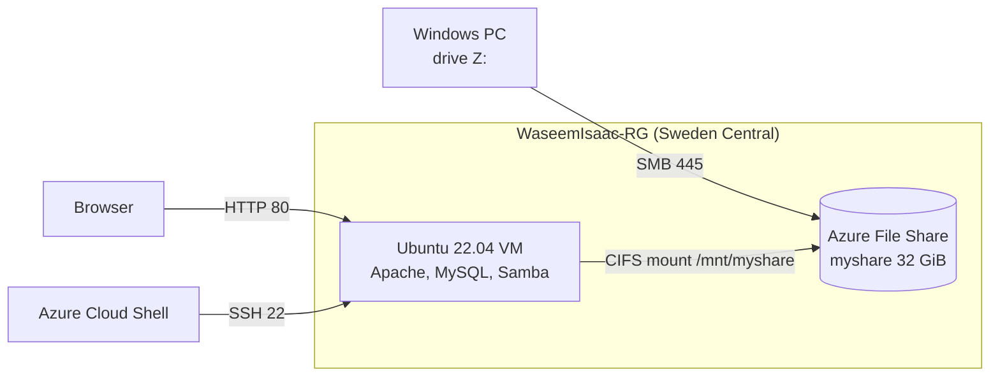

## Requirements checklist

| # | Assignment requirement | Solution | Status |
|---|---|---|---|
| 1 | Create an Azure account | Azure Free Trial; plan and spending limit verified with the Azure CLI | ✅ |
| 2 | Create a resource group | `WaseemIsaac-RG` | ✅ |
| 3 | Create a virtual machine | Ubuntu Server 22.04 LTS, `Standard_B2ats_v2`, Sweden Central, SSH key | ✅ |
| 4 | Connect to the VM | SSH from Azure Cloud Shell to the public IP | ✅ |
| 5 | Create and connect an Azure File Share | Storage account + share `myshare`; **CIFS mount on Linux** and **mapped drive Z: on Windows** | ✅ |
| 6 | Optional Linux tasks | Apache web site, MySQL database, Samba share, file create/read/delete on the share | ✅ |
| 7 | GitHub + LinkedIn submission | This repository and a LinkedIn post that mentions the trainer | ✅ |
| 8 | Clean up resources | Resource group deletion (see [Clean-up](#clean-up)) | ✅ |

## Environment

| Item | Value |
|---|---|
| Subscription | Azure Free Trial (spending limit **On**) |
| Resource group | `WaseemIsaac-RG` |
| Virtual machine | `WaseemIsaac-VM`, Ubuntu Server 22.04 LTS (Canonical), x64 Gen2 |
| Size | `Standard_B2ats_v2` (2 vCPU, 1 GiB RAM) |
| OS disk | Standard SSD (LRS) |
| Authentication | SSH public key, user `azureuser` |
| Storage account | `waseemisaac2026wa` (locally redundant) |
| File share | `myshare`, SMB, 32 GiB provisioned |
| Open ports | 22 (SSH) and 80 (HTTP) only |

---

## Step-by-step summary

> Every screenshot is in [`docs/screenshots`](docs/screenshots). E-mail addresses, the subscription ID and the directory name are redacted; secrets are never shown. The complete walkthrough with all commands is in the [full report](Azure_VM_FileShare_Assignment_Report.docx).

### 1. Azure account

Free Trial subscription. Because it was created with a work e-mail, the type was verified from Cloud Shell:

```bash
az rest --method get \
  --url "https://management.azure.com/subscriptions/<SUBSCRIPTION_ID>?api-version=2020-01-01" \
  --query "{plan:subscriptionPolicies.quotaId, spendingLimit:subscriptionPolicies.spendingLimit}"
# { "plan": "FreeTrial_2014-09-01", "spendingLimit": "On" }
```

### 2. Resource group

Portal > Resource groups > Create > `WaseemIsaac-RG` (West Europe).

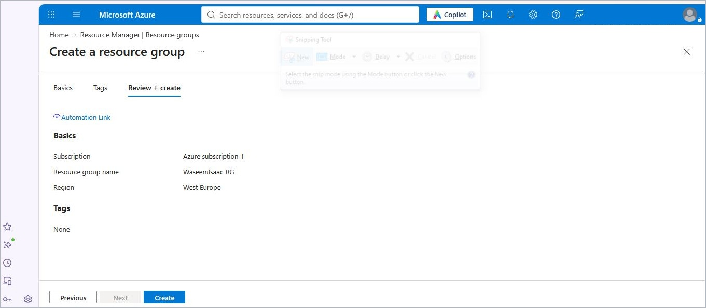

### 3. Virtual machine

Created with the Azure CLI ([`scripts/create-vm.sh`](scripts/create-vm.sh)) using the official Canonical image:

```bash
az vm create \
  --resource-group WaseemIsaac-RG --name WaseemIsaac-VM --location swedencentral \
  --image Canonical:0001-com-ubuntu-server-jammy:22_04-lts-gen2:latest \
  --size Standard_B2ats_v2 --storage-sku StandardSSD_LRS \
  --admin-username azureuser --generate-ssh-keys \
  --public-ip-sku Standard --nsg-rule SSH
```

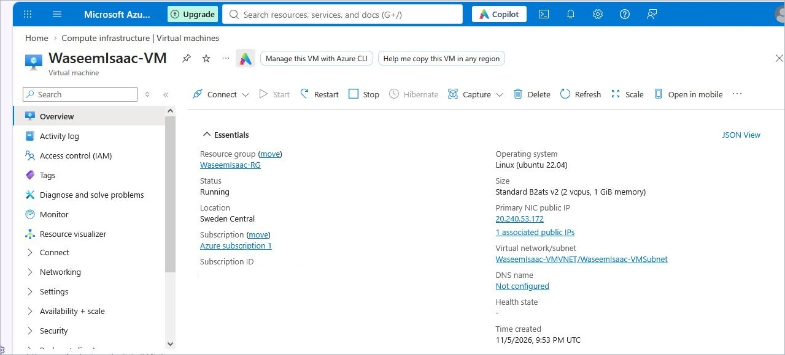

### 4. Connect over SSH

```bash
ssh azureuser@<PUBLIC_IP>
```

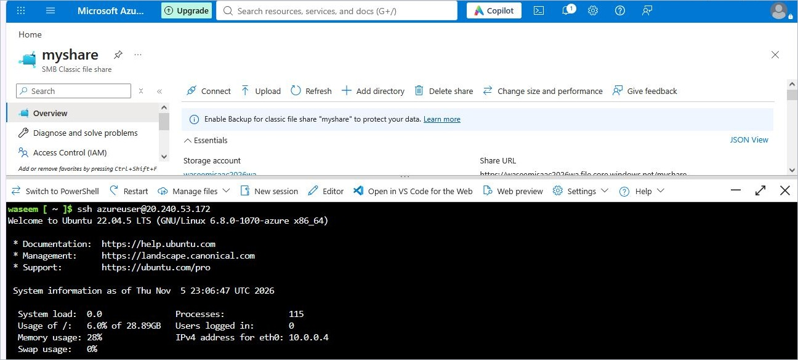

### 5. Azure File Share

<details>
<summary><b>5.1 Storage account and file share</b></summary>

Storage account `waseemisaac2026wa` (Sweden Central, LRS) and the SMB share `myshare` (32 GiB).

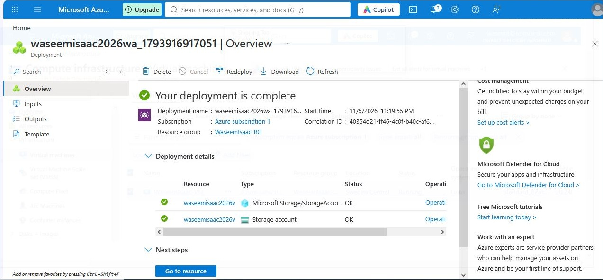
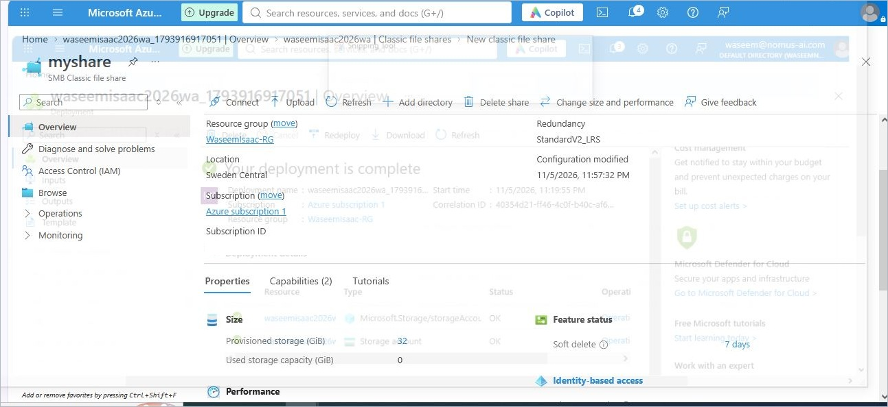

</details>

<details>
<summary><b>5.2 Mount on Linux (CIFS) and create / read / delete a file</b></summary>

```bash
export STORAGE_KEY='<storage-account-key>'   # never commit the key
./scripts/mount-fileshare.sh
```

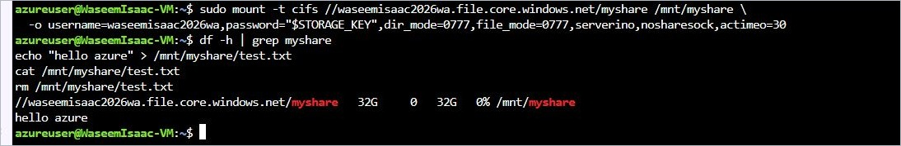
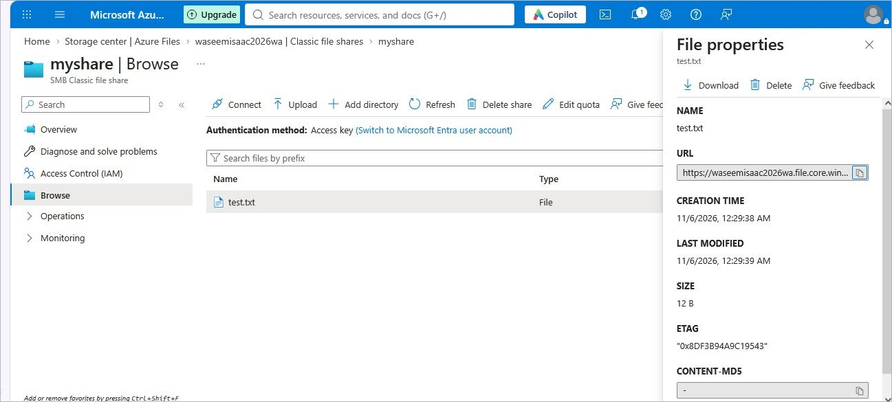

</details>

<details>
<summary><b>5.3 Map as a drive on Windows</b></summary>

```powershell
net use Z: \\waseemisaac2026wa.file.core.windows.net\myshare /user:localhost\waseemisaac2026wa <STORAGE_KEY>
Set-Content Z:\test-from-pc.txt "hello from my PC"
Get-ChildItem Z:\
Get-Content Z:\test-from-pc.txt
```

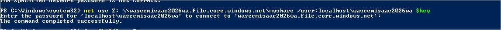
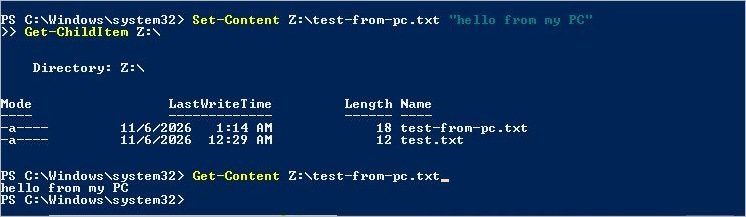

</details>

<details>
<summary><b>5.4 Proof that the PC and the VM share the same files</b></summary>

A file created on the PC (`shared-check.txt`) was read on the VM.

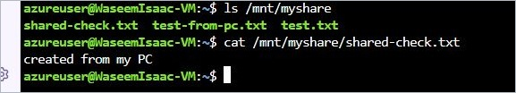

</details>

### 6. Optional tasks on the Linux VM

All commands: [`scripts/setup-linux-services.sh`](scripts/setup-linux-services.sh).

<details>
<summary><b>Swap, Apache web site, MySQL database, Samba share</b></summary>

**Swap (1 GiB RAM only)**

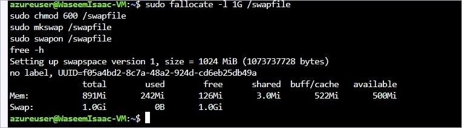

**Apache web site** (port 80 opened with `az vm open-port`)

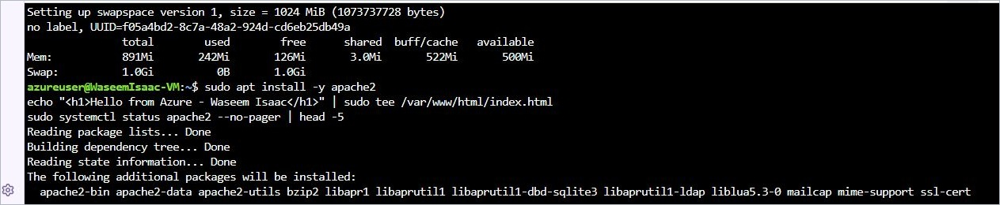
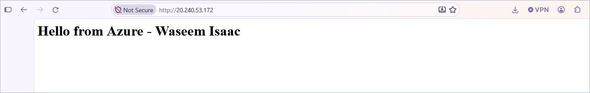

**MySQL database** `studentdb`

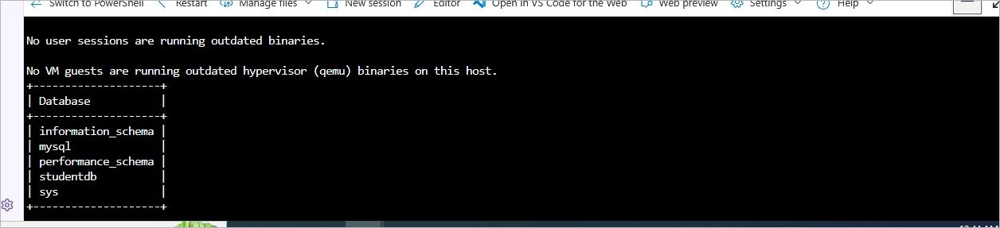

**Samba share** (tested locally; port 445 is intentionally not exposed to the Internet)

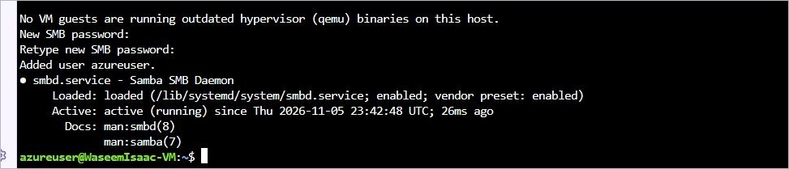
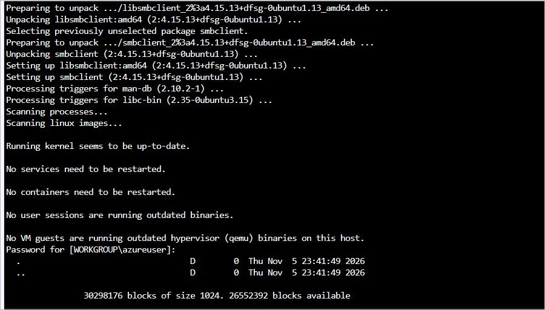
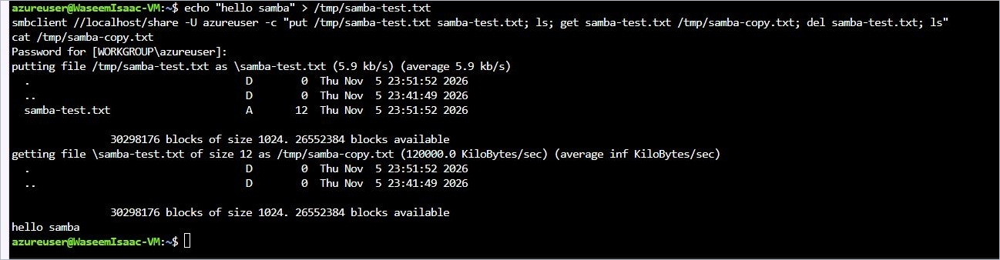

</details>

---

## Problems and solutions

| # | Problem | Cause | Solution |
|---|---|---|---|
| 1 | `Standard_B1s` unavailable (`NotAvailableForSubscription`) in several regions | Size restricted for this subscription | Listed allowed sizes with `az vm list-skus`; used `Standard_B2ats_v2` in Sweden Central |
| 2 | Unsure the account was a free subscription | Portal did not show the *Offer* column | Queried the subscription policy with `az rest` (FreeTrial, spending limit On) |
| 3 | VM creation failed: *cannot purchase paid Marketplace offers* | Portal picked a third-party Ubuntu image | Created the VM with the CLI and the official Canonical image |
| 4 | SSH `Permission denied (publickey)` | The VM accepts only its SSH key | Generated a key in Cloud Shell and added it with `az vm user update` |
| 5 | `az: command not found` on the VM | Azure CLI exists in Cloud Shell, not on the VM | Ran `az` commands in Cloud Shell, Linux commands on the VM |
| 6 | Windows `net use` System error 86 | Key not accepted when pasted into the prompt | Cleared old connections and typed the key again at the prompt |
| 7 | Samba `NT_STATUS_LOGON_FAILURE` | Samba password differs from the Linux password | Reset it with `sudo smbpasswd -a azureuser` |
| 8 | Only 1 GiB RAM for MySQL | Small burstable VM size | Added a 1 GiB swap file first |

## Security and cost control

- SSH key authentication only; private key and storage account key are **not** in this repository.
- Only ports 22 and 80 are open; Samba (445) is not exposed to the Internet.
- Standard SSD, LRS replication and the smallest suitable VM size to keep cost low.
- Trial spending limit kept **On** (no upgrade to pay-as-you-go).
- Personal identifiers are redacted from every screenshot.

## Clean-up

All resources live in one resource group, so deleting it removes the VM, disk, network, public IP and storage account together:

```bash
az group delete --name WaseemIsaac-RG --yes --no-wait
```

Or run [`scripts/cleanup.sh`](scripts/cleanup.sh) in Azure Cloud Shell.

## Repository structure

```text
Cloud-Azure-platform-assignment/
├── README.md
├── Azure_VM_FileShare_Assignment_Report.docx   # full report with all steps and screenshots
├── docs/
│   └── screenshots/                            # 18 redacted screenshots
└── scripts/
    ├── create-vm.sh                            # resource group, VM, open port 80
    ├── mount-fileshare.sh                      # CIFS mount + create/read/delete test
    ├── setup-linux-services.sh                 # swap, Apache, MySQL, Samba
    └── cleanup.sh                              # delete the resource group
```

---

**Author:** Waseem Isaac & Dana Obid  &nbsp;|&nbsp; **Trainer:** [Yavuz Koksal](https://www.linkedin.com/in/yavuz-koksal) &nbsp;|&nbsp; `#Azure` `#CloudComputing` `#VirtualMachine`
